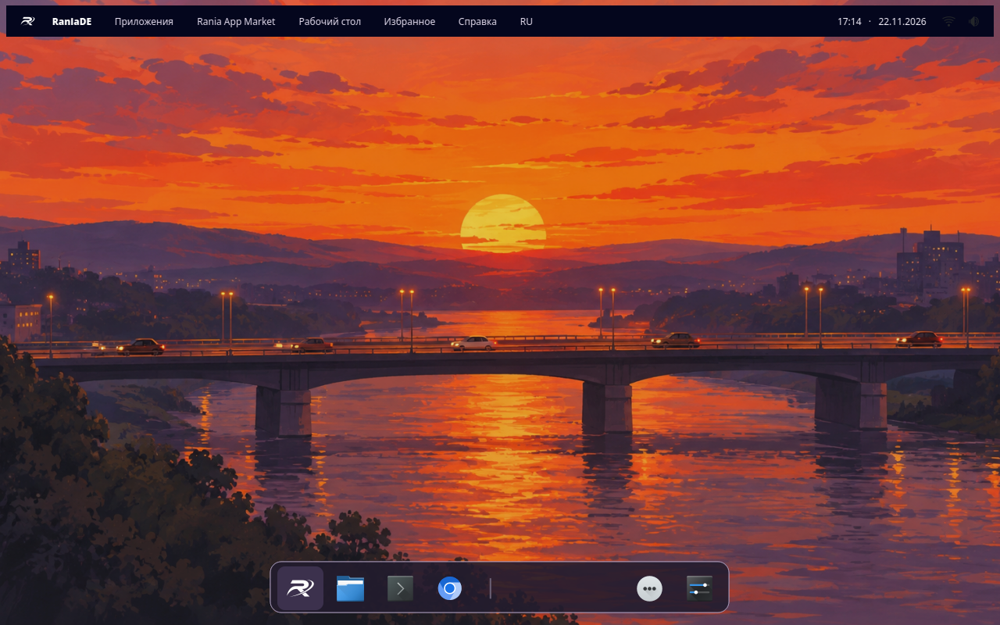

# RaniaDE

A lightweight custom desktop shell for Linux/X11, built with Python and PyQt5. RaniaDE provides its own panels, application launcher and Rania App Market window, while relying on an existing X11 window manager (for example, KWin or Openbox). It is an independent shell, not KDE Plasma.

**Interface languages:** Russian and English. **Screenshots:** full-screen captures at 1280×800 are in [`screenshots/`](screenshots/).




## Install and run (English)

### Requirements

On Debian or Ubuntu, install Python 3, PyQt5 and an X11 window manager:

```bash
sudo apt update
sudo apt install python3 python3-pyqt5 openbox
```

KWin can be used instead of Openbox if you want KDE-style window frames:

```bash
sudo apt install kwin-x11
```

You need an active **X11** graphical session. Wayland-only sessions are not currently supported. If a window manager is already running, keep using it; do not start a second one.

### Install

Clone the repository and run the included installer as your regular user (not with `sudo`):

```bash
git clone https://github.com/lolartem26-max/RaniaDE.git
cd RaniaDE
./install.sh
```

The installer copies the shell to `~/.local/bin/rania-shell.py` and its start icon to `~/.local/share/icons/rania-start-white.png`. It does not install system packages or change your login/session configuration.

### Launch

From a terminal **inside your active X11 desktop session**, run:

```bash
python3 ~/.local/bin/rania-shell.py
```

If you are starting from a text console, first start an X11 session and a window manager; the shell cannot create an X server by itself. RaniaDE is not configured as a display-manager login session by this installer.

To use your own wallpaper, set its path when launching (the image itself is not included):

```bash
RANIADE_WALLPAPER="$HOME/Pictures/wallpaper.png" python3 ~/.local/bin/rania-shell.py
```

### Change the interface language

Use **Language** in the top panel and choose **English** or **Russian**. The shell restarts itself to apply the selection; your window manager and other applications are not restarted. The selection is saved in `~/.config/rania/language` and remains active the next time you launch RaniaDE. The default language is Russian.

## Установка и запуск (русский)

### Что понадобится

Для Debian или Ubuntu установите Python 3, PyQt5 и оконный менеджер X11:

```bash
sudo apt update
sudo apt install python3 python3-pyqt5 openbox
```

Вместо Openbox можно использовать KWin, если нужны рамки окон в стиле KDE:

```bash
sudo apt install kwin-x11
```

Нужен запущенный графический сеанс **X11**. Сеанс только Wayland пока не поддерживается. Если оконный менеджер уже запущен, оставьте его работать — не запускайте второй.

### Установка

Склонируйте репозиторий и запустите установщик от обычного пользователя (без `sudo`):

```bash
git clone https://github.com/lolartem26-max/RaniaDE.git
cd RaniaDE
./install.sh
```

Установщик копирует оболочку в `~/.local/bin/rania-shell.py`, а иконку запуска — в `~/.local/share/icons/rania-start-white.png`. Он не устанавливает системные пакеты и не меняет настройки входа в систему.

### Запуск

Откройте терминал **внутри уже запущенного графического сеанса X11** и выполните:

```bash
python3 ~/.local/bin/rania-shell.py
```

Если вы находитесь в текстовой консоли, сначала запустите графический сеанс X11 и оконный менеджер: сама оболочка не создаёт X-сервер. Установщик не настраивает RaniaDE как отдельный сеанс на экране входа.

Чтобы использовать свои обои, задайте путь при запуске (файл изображения в репозиторий не включён):

```bash
RANIADE_WALLPAPER="$HOME/Pictures/wallpaper.png" python3 ~/.local/bin/rania-shell.py
```

### Смена языка интерфейса

Нажмите **«Язык»** на верхней панели и выберите **English** или **Русский**. Оболочка перезапустится, чтобы применить выбор; оконный менеджер и другие приложения не перезапускаются. Язык сохраняется в `~/.config/rania/language` и останется выбранным при следующем запуске. По умолчанию используется русский.

## Repository contents

- `src/rania-shell.py` — RaniaDE shell source.
- `assets/rania-start-white.png` — custom start icon used by the shell.
- `screenshots/RaniaDE-English.png` and `screenshots/RaniaDE-Russian.png` — full-screen screenshots in both interface languages.
- `install.sh` — user-local installer.
- `LICENSE` — MIT License.

No wallpaper file, VNC/noVNC password, account credential or machine/session configuration is included.

## License

MIT; see [`LICENSE`](LICENSE).
